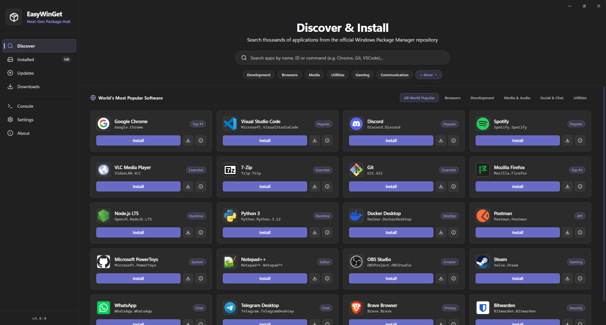

# 🚀 EasyWinGet

<div align="center">



**Next-Generation Native Windows Package Management Hub**  
*Ultra-fast, lightweight, modern desktop GUI for Windows Package Manager (`winget`).*  
*Built from the ground up with **Go (Golang)**, **Wails v2**, and **Svelte 5**.*

[](https://github.com/DARKBOYJYOTI/EasyWinget/releases)
[](https://github.com/DARKBOYJYOTI/EasyWinget/actions)
[-blue?style=flat-square&logo=windows)](https://github.com/DARKBOYJYOTI/EasyWinget)
[](https://golang.org)
[](https://svelte.dev)
[](LICENSE)

[Download Installer](https://github.com/DARKBOYJYOTI/EasyWinget/releases/latest) • [Download Portable ZIP](https://github.com/DARKBOYJYOTI/EasyWinget/releases/latest) • [Report Bug](https://github.com/DARKBOYJYOTI/EasyWinget/issues) • [Request Feature](https://github.com/DARKBOYJYOTI/EasyWinget/issues)

</div>

---

## 📖 Overview

**EasyWinGet** transforms the command-line Windows Package Manager (`winget`) into an elegant, responsive, and distraction-free Windows 11 desktop experience. 

Unlike heavy Electron-based wrappers that consume hundreds of megabytes of RAM, EasyWinGet is compiled directly into a native Windows binary using **Go** and **Wails v2** (leveraging native Microsoft Edge WebView2). It starts up in milliseconds, utilizes negligible system resources, and provides instant local caching via an embedded pure Go SQLite engine.

Whether you prefer a traditional **Windows Setup Wizard** with desktop shortcuts and taskbar pinning or a 100% self-contained **Portable Edition** that runs seamlessly off a USB thumb drive, EasyWinGet has you covered.

---

## ✨ Key Features

### ⚡ Pure Go Performance & Sub-Millisecond SQLite Caching
- **Zero Electron Overhead**: Consumes a tiny fraction of memory compared to web-wrapped tools.
- **Pure Go Embedded SQLite 3**: CGO-free local database running in WAL (Write-Ahead Logging) mode, providing instant package queries and offline catalog caching.
- **Single Instance Guard**: Prevents duplicate processes and automatically brings existing minimized or running windows to the foreground.

### 📦 Dual Distribution Modes
- **Setup Installer (`EasyWinGet-amd64-installer.exe`)**:
  - Full NSIS Setup Wizard with customizable scope (Machine or Current User).
  - Creates Desktop & Start Menu shortcuts, uninstaller entry in Windows Settings.
  - Includes automated Windows 10/11 taskbar pinning.
- **Portable Edition (`EasyWinGet-portable.zip`)**:
  - Completely self-contained! All database files, scraped app icons, job logs, and downloads are stored locally inside `data/`, `downloads/`, and `jobs/` alongside `EasyWinGet.exe`.
  - Zero registry trace, no `%LOCALAPPDATA%` pollution—ideal for system administrators and USB toolkits.

### 🔍 Instant Package Search & Discovery
- Fast search across tens of thousands of community WinGet manifests with smart debouncing.
- Categorized exploration (Development, Browsers, Media, Social, Utilities, Gaming, and Security).
- Instant chips and category filtering with clean keyboard navigation.

### 📦 Installed Applications & Deep Registry Scanner
- **Hybrid Package Discovery**: Combines official WinGet manifests with a high-speed BCUninstaller-style Win32 Registry scanner (both 64-bit and 32-bit `WOW6432Node`).
- Deep search filter with instant keyboard shortcuts (`Esc` to clear, smooth backspace handling, and guaranteed unique key rendering).
- One-click uninstallation with elevated UAC integration.
- **Import & Export**: Backup your installed applications list to JSON and restore them effortlessly on a new PC.

### 🔄 One-Click Updates Center
- Automated outdated package detection with visual version diffs (`v1.0.0 ➔ v1.2.0`).
- **Update All**: Upgrade all outdated applications in an automated queue.
- **Ignore Updates**: Hide updates for specific packages or custom builds you wish to freeze.
- **Background Update Checker**: Configurable background checks with native Windows notifications and automatic 24-hour reminder throttling.

### 🖥️ Real-Time Job Terminal & Background Dock
- Real-time goroutine log streaming via Wails event bus (`job:log`, `job:done`).
- Interactive console with stdin input support and one-click task cancellation.
- Minimizes into a discreet floating status bar when browsing other tabs during active operations.

### 💾 Offline Downloads Manager
- Download installers (`.exe`, `.msi`, `.msix`) directly to local storage without executing them.
- Ideal for offline deployment, archival, and distribution.

### 🚀 Integrated App Self-Update
- Automatically checks GitHub Releases on startup.
- Displays a clean Fluent 2 modal with release notes, "Update Now", and a once-per-day "Remind Me Later" option.

### 🎨 Windows 11 Fluent 2 Aesthetics
- Native Win32 DWM **Mica translucency** and acrylic material effects.
- Dynamic auto-luminance color calculations matching your Windows personalization accent color.
- Three-way theme toggle: Light, Dark, or System Auto.

---

## 📥 Download & Installation

Visit the [Releases Page](https://github.com/DARKBOYJYOTI/EasyWinget/releases/latest) to download the latest version:

| Package | Format | Description |
| :--- | :--- | :--- |
| **EasyWinGet Setup** | `.exe` Installer | Full Windows Setup Wizard with shortcuts & taskbar pinning |
| **EasyWinGet Portable** | `.zip` Archive | Zero-install, self-contained portable edition for USB drives |
| **Standalone Binary** | `.exe` Executable | Single standalone executable |

All release assets include SHA-256 checksums (`checksums-sha256.txt`) for cryptographic verification.

---

## 🛠️ Building From Source

### Prerequisites
1. **Operating System**: Windows 10 (Build 1809+) or Windows 11 (64-bit).
2. **Go**: Version `1.23` or newer ([golang.org](https://golang.org)).
3. **Node.js**: Version `20` or newer with npm ([nodejs.org](https://nodejs.org)).
4. **Wails CLI**:
   ```powershell
   go install github.com/wailsapp/wails/v2/cmd/wails@latest
   ```
5. **NSIS** *(Optional, required only for building the setup installer)*:
   ```powershell
   choco install nsis -y
   ```

### Clone Repository
```powershell
git clone https://github.com/DARKBOYJYOTI/EasyWinget.git
cd EasyWinget
```

### Live-Reload Development Mode
Runs the application with hot-reloading for both Go backend and Svelte frontend:
```powershell
wails dev
```

### Build Standalone Executable
Compiles the production executable into `build/bin/EasyWinGet.exe`:
```powershell
wails build
```

### Build Full Setup Installer (.exe)
Generates `build/bin/EasyWinGet-amd64-installer.exe`:
```powershell
powershell -ExecutionPolicy Bypass -File scripts/build_installer.ps1
```

For a non-elevated user-scope installer:
```powershell
powershell -ExecutionPolicy Bypass -File scripts/build_installer.ps1 -Scope user
```

### Build Portable Edition (.zip)
Generates `build/bin/EasyWinGet-portable.zip`:
```powershell
powershell -ExecutionPolicy Bypass -File scripts/build_portable.ps1
```

---

## 🏗️ Architecture & Project Structure

```
EasyWinGet/
├── .github/
│   └── workflows/
│       ├── build.yml         # Continuous integration & test workflow
│       └── release.yml       # Automated tag release & asset publisher
├── backend/                  # Pure Go Backend Services
│   ├── db/                   # High-speed SQLite 3 database (WAL mode)
│   ├── downloads/            # Offline installer file manager
│   ├── icons/                # Local PE icon extraction & Google S2 favicons
│   ├── installed/            # Native Windows Registry package scanner
│   ├── jobs/                 # Real-time goroutine job runner & stream broadcaster
│   ├── models/               # Shared data structures
│   ├── system/               # Windows accent color, Mica, paths & portable resolver
│   └── winget/               # Windows Package Manager CLI parser & wrapper
├── frontend/                 # Svelte 5 + Vite Modern UI
│   ├── src/
│   │   ├── components/       # Fluent 2 modular components
│   │   ├── utils/            # Accent color luminance & icon resolvers
│   │   ├── App.svelte        # Root coordinator & modal manager
│   │   ├── main.js           # Frontend entry point
│   │   └── style.css         # Windows 11 design tokens & styles
│   └── wailsjs/              # Auto-generated Go-to-JS bridge bindings
├── build/
│   └── windows/
│       └── installer/        # NSIS installer script & taskbar pinning script
├── scripts/                  # Automated build & packaging scripts
├── app.go                    # Wails runtime bridge & API surface
├── main.go                   # Window entry point, Mica backdrop, single instance lock
├── wails.json                # Wails v2 project configuration
└── go.mod                    # Go module definitions
```

---

## 🔒 Security & Privacy

- **Open Source & Transparent**: All code is open-source under the MIT license with zero telemetry or tracking.
- **Native Execution**: WinGet operations are executed directly against the local Microsoft Windows Package Manager CLI.
- **Safe Persistence**:
  - In Installed Mode, data is isolated to `%LOCALAPPDATA%\EasyWinGet\`.
  - In Portable Mode, data is strictly isolated to the application folder.
- **Cryptographic Verification**: Every release includes SHA-256 checksums to verify binary integrity.

---

## 🤝 Contributing

Contributions, feature suggestions, and bug reports are welcome!
1. Fork the repository.
2. Create your feature branch (`git checkout -b feature/amazing-feature`).
3. Commit your changes (`git commit -m 'feat: add amazing feature'`).
4. Push to the branch (`git push origin feature/amazing-feature`).
5. Open a Pull Request.

---

## 📄 License

This project is licensed under the **MIT License** — see the [LICENSE](LICENSE) file for details.

Developed with ❤️ by **[DARKBOYJYOTI](https://github.com/DARKBOYJYOTI)**.
